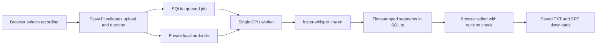

# Small Hours implementation

The browser sends a multipart recording, then polls job state while work is pending. No progress percentage is fabricated: queued, processing, completed and failed are actual persisted states. A single worker claims queued jobs transactionally. On restart, unfinished processing jobs return to the queue. Completed transcripts persist without reprocessing.

Audio uses generated UUID filenames; original names are display labels. Uploads are bounded by size, duration, saved-job count and pending-job count. Both preflight and transactional insertion recheck limits. Invalid uploads are removed. Deletion removes the database record and recording; a worker completing afterward cannot recreate a deleted record.

Users correct each segment's text while keeping recognized timing. Saving checks the revision in a transaction, preventing a stale tab from overwriting a newer edit. Downloads read the saved segments. The UI keeps unsaved text if a save fails and asks before leaving it. Model inference, media decoding and UI interaction are separate boundaries verified by the actual-model browser test.

The first version is English, CPU-only and local-only. Short files, a small model and one worker keep the workflow understandable on modest hardware. There is no hosted multi-user isolation, remote queue broker or claim of production speech accuracy. A real deployment would need those decisions revisited; this project intentionally avoids cloud spending.

The real-audio check uncovered an upstream incompatibility: faster-whisper 1.2.1 passed a keyword removed by PyAV 19. Pinning PyAV 18.1.0 restored decoding, followed by a repeat of actual transcription and browser export checks. See `testing.md` for the evidence and reproducible commands.
